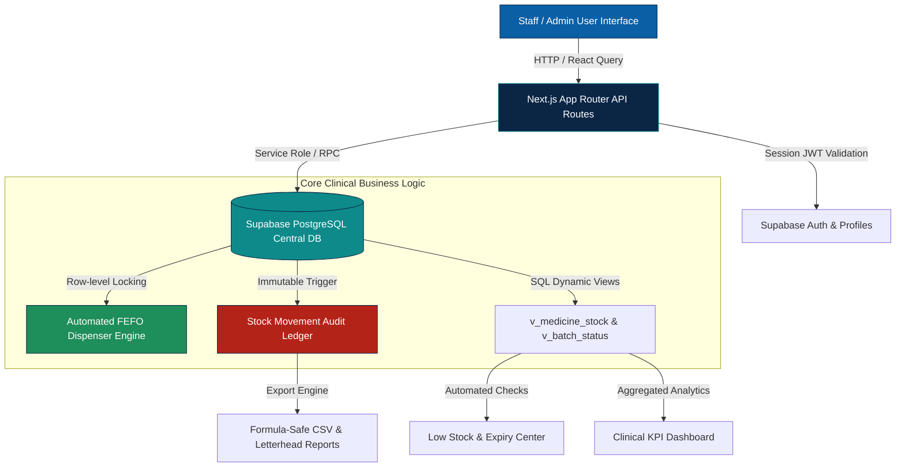

# PharmaTrack — Pharmacy Inventory Management System

> **Smart • Fast • Accurate • Reliable**  
> *Right Medicine • Right Quantity • Right Time • Minimum Waste*

**PharmaTrack** is an enterprise-grade, clinical pharmacy inventory management web application developed as a B.Tech CSE (AI) capstone project by **Shreya Jaiswal**. 

It eliminates error-prone paper registers and manual spreadsheets by providing **automated First-Expire, First-Out (FEFO) dispensing**, **tamper-evident audit movement ledgers**, **real-time expiry & stock level warnings**, and **regulatory CSV/Print reporting**.

---

## 1. System Architecture & Methodology Flow



### Academic Context & Methodology:
- **Problem Statement**: Traditional pharmacy operations suffer from physical register errors, poor visibility into expiring shelf life, stock-outs of essential antibiotics, and missing batch traceability.
- **Methodology Sequence**:
  $$\text{User Input} \longrightarrow \text{Medicine Entry} \longrightarrow \text{Central Database} \longrightarrow \text{Automated Checks} \longrightarrow \text{Reports \& Alerts}$$

---

## 2. Core Functional Modules

1. **Clinical KPI Dashboard**: Real-time inventory cards, 10-row priority attention table, donut category distributions, 12-month purchasing lines, and low-stock bar charts.
2. **Master Medicine Catalog**: Paginated catalog, multi-criteria search, category & status filtering, composite uniqueness enforcement `(name, strength, dosage_form)`.
3. **Automated FEFO Stock Dispenser**:
   - Live client preview of batch allocations before confirming dispensing.
   - Atomic database execution (`dispense_stock` RPC) locking batches in order: `expiry_date ASC, received_date ASC, created_at ASC`.
   - Never touches expired batches (`expiry_date < today`).
   - Aborts atomically with `INSUFFICIENT_STOCK` if capacity cannot fulfill the request.
4. **Tamper-Evident Movement Ledger**: Immutable ledger of all receipts, clinical dispenses, adjustments, and expired write-offs. A PostgreSQL database trigger strictly raises an exception on `UPDATE` or `DELETE`.
5. **Dynamic Multi-Line Procurement**: Create multi-batch purchase orders with live line totals and invoice generation.
6. **Regulatory Reports & Export**:
   - 5 standard audit reports (Stock Summary, Low Stock, Expiry, Purchases, Movements).
   - CSV export featuring UTF-8 BOM encoding for Microsoft Excel and automatic formula-injection sanitization (`= + - @`).
   - Clinical letterhead printable layout with signature blocks.
7. **Role-Based Access Control (RBAC)**:
   - `admin`: Full administrative control, user provisioning, system configuration, write-offs, and deactivations.
   - `staff` (Pharmacist): Medicine management, batch receipt, FEFO dispensing, audit inspections. Restricted from user administration and system settings.

---

## 3. Technology Stack

- **Framework**: Next.js `14.2.24` (App Router, synchronous `cookies()`)
- **Runtime & Language**: Node.js `20 LTS`, TypeScript `5.5` (Strict Mode)
- **UI Components & Icons**: Tailwind CSS `3.4.17`, shadcn/ui, Radix UI primitives, Lucide React (Strictly zero emojis)
- **Database & Auth**: Supabase PostgreSQL + Auth (`@supabase/ssr` & `@supabase/supabase-js` v2)
- **Data Fetching & State**: `@tanstack/react-query` v5
- **Charts & Visualization**: Recharts v2
- **Validation**: Zod 3.x with shared client/server schemas
- **Testing**: Vitest (`tests/inventory.test.ts`, `tests/csv.test.ts`)
- **Deployment**: Vercel (Edge routing, serverless API route handlers, daily cron)

---

## 4. Default Credentials & Slide Parity Dataset

### Seeded Institutional Accounts:
| Role | Email | Password | Privileges |
| :--- | :--- | :--- | :--- |
| **System Administrator** | `admin@pharmacy.com` | `Admin@123` | Full Access, Users, Settings, Write-Offs |
| **Staff Pharmacist** | `staff@pharmacy.com` | `Staff@123` | Dispensing, Stock In/Out, Reports |

### Presentation Slide Exact Parity Data:
The seed dataset contains the exact medicines featured on the project presentation slide:
1. **Paracetamol 500mg**: Reorder level 20, 3 batches totaling **120 units**:
   - `PCM-2411A`: 40 units (Exp: 2027-12-15)
   - `PCM-2411B`: 50 units (Exp: 2027-12-31)
   - `PCM-2412C`: 30 units (Exp: 2027-12-31)
   - *Status*: **Available** (Shown Expiry: 12/2027)
2. **Amoxicillin 250mg**: Reorder level 20, total **18 units** (Exp: 2027-04-30).
   - *Status*: **Low Stock**
3. **Vitamin D3**: Reorder level 20, total **65 units** (Exp: 2027-01-31).
   - *Status*: **Available**
4. **Cough Syrup**: Reorder level 15, total **8 units** (Exp: 2026-11-30).
   - *Status*: **Low Stock** + **Near Expiry** secondary badge.

*(Note: Statuses are evaluated dynamically against `app_today()`, so as dates advance, items naturally transition into near-expiry and expired states).*

---

## 5. Local Setup & Installation

### Option A: One-Click Setup Script (Recommended)
We provide an automated installer in the `requirements/` directory:
- **Windows**: Double-click `requirements/setup.bat`
- **Linux / macOS**: Run `bash requirements/setup.sh`

### Option B: Manual Setup
1. **Clone the repository**:
   ```bash
   git clone <repo-url>
   cd StockRX
   ```
2. **Ensure Node.js 20 LTS is active**:
   ```bash
   node -v # Should report v20.x or higher
   ```
3. **Install dependencies**:
   ```bash
   npm install
   ```
4. **Configure Environment Variables**:
   Copy `.env.example` to `.env.local` and add your Supabase credentials:
   ```bash
   cp .env.example .env.local
   ```
   ```env
   NEXT_PUBLIC_SUPABASE_URL=https://<your-project-id>.supabase.co
   NEXT_PUBLIC_SUPABASE_ANON_KEY=eyJhbGci...
   SUPABASE_SERVICE_ROLE_KEY=eyJhbGci...
   CRON_SECRET=pharmatrack_secure_cron_secret_key_2026_production
   NEXT_PUBLIC_APP_URL=http://localhost:3000
   ```
5. **Execute Database Migrations**:
   Open your Supabase Project Dashboard -> **SQL Editor**, and execute the migration files in order:
   - `supabase/migrations/001_schema.sql`
   - `supabase/migrations/002_functions.sql`
   - `supabase/migrations/003_views.sql`
   - `supabase/migrations/004_security.sql`
6. **Seed Initial Data**:
   ```bash
   npm run seed
   ```
7. **Run Unit Tests**:
   ```bash
   npm test
   ```
8. **Start Local Development Server**:
   ```bash
   npm run dev
   ```
   Open `http://localhost:3000` in your web browser.

---

## 6. Package Scripts

| Command | Action |
| :--- | :--- |
| `npm run dev` | Starts the Next.js local development server with Hot Module Reloading |
| `npm run build` | Compiles optimized production bundle with static page generation |
| `npm run start` | Starts Next.js production server |
| `npm run typecheck` | Validates TypeScript strict mode (`tsc --noEmit`) |
| `npm run lint` | Runs Next.js ESLint verification |
| `npm test` | Runs Vitest unit test suite |
| `npm run seed` | Runs idempotent TypeScript database seeder via `tsx` |

---

## 7. Complete API Reference Table

All routes enforce server-side authentication and role authorization via `lib/api/handler.ts`.

| Method | Endpoint | Authorized Roles | Description |
| :--- | :--- | :--- | :--- |
| `POST` | `/api/auth/login` | Public (Rate-limited) | Verifies email & password, sets secure session cookies |
| `POST` | `/api/auth/logout` | Authenticated | Clears auth session cookies |
| `GET` | `/api/auth/me` | Authenticated | Retrieves current authenticated user profile and role |
| `POST` | `/api/auth/change-password` | Authenticated | Changes current user password (verifies old password) |
| `GET` | `/api/users` | `admin` | Lists all staff accounts and system roles |
| `POST` | `/api/users` | `admin` | Provisions new authorized staff account |
| `PATCH` | `/api/users/[id]` | `admin` | Updates user full name, role, or active status (self-protected) |
| `POST` | `/api/users/[id]/reset-password` | `admin` | Administratively sets a new password for staff account |
| `GET` | `/api/settings` | `admin` | Retrieves global pharmacy settings |
| `PATCH` | `/api/settings` | `admin` | Updates facility name, near-expiry days, and default reorder |
| `GET` | `/api/categories` | Authenticated | Retrieves all therapeutic medicine categories |
| `GET` | `/api/medicines` | Authenticated | Paginated catalog from `v_medicine_stock` with search & filters |
| `POST` | `/api/medicines` | Authenticated | Adds a new medicine to catalog |
| `GET` | `/api/medicines/[id]` | Authenticated | Fetches medicine details, batches, and recent movements |
| `PATCH` | `/api/medicines/[id]` | Authenticated | Modifies medicine details and reorder thresholds |
| `DELETE` | `/api/medicines/[id]` | `admin` | Soft-deletes medicine (rejects if physical stock remains) |
| `GET` | `/api/suppliers` | Authenticated | Retrieves vendor directory |
| `POST` | `/api/suppliers` | Authenticated | Registers a new pharmaceutical supplier |
| `GET` | `/api/suppliers/[id]` | Authenticated | Retrieves supplier details and complete invoice history |
| `PATCH` | `/api/suppliers/[id]` | Authenticated | Updates supplier contact information |
| `DELETE` | `/api/suppliers/[id]` | `admin` | Deactivates supplier |
| `GET` | `/api/batches` | Authenticated | Lists batches with expiry calculations |
| `GET` | `/api/batches/[id]` | Authenticated | Fetches batch details |
| `GET` | `/api/purchases` | Authenticated | Lists purchase invoices with supplier and date filters |
| `POST` | `/api/purchases` | Authenticated | Executes `create_purchase` RPC with dynamic batch rows |
| `GET` | `/api/purchases/[id]` | Authenticated | Retrieves invoice details, items, and billing totals |
| `POST` | `/api/stock/out` | Authenticated | Executes automated FEFO dispense (`dispense_stock` RPC) |
| `POST` | `/api/stock/in` | Authenticated | Quick single-batch receipt entry |
| `POST` | `/api/stock/adjust` | Authenticated | Records audit adjustment with mandatory reason note |
| `POST` | `/api/stock/write-off` | `admin` | Quarantines and writes off expired batch (`write_off_expired` RPC) |
| `GET` | `/api/stock/movements` | Authenticated | Paginated, filterable immutable audit movements |
| `GET` | `/api/expiry/near` | Authenticated | Batches expiring within 30, 60, or 90 days |
| `GET` | `/api/expiry/expired` | Authenticated | Expired batches currently in stock |
| `GET` | `/api/alerts` | Authenticated | Live counts and item lists for low stock, near expiry, and expired |
| `GET` | `/api/dashboard/summary` | Authenticated | Total stock units, valuation, low stock count, expired count |
| `GET` | `/api/dashboard/charts` | Authenticated | Recharts data: category breakdown, 12-month spend, top low-stock |
| `GET` | `/api/dashboard/recent-activity` | Authenticated | 10 most recent verified ledger stock movements |
| `GET` | `/api/reports/[type]` | Authenticated | Generates CSV download or JSON preview for 5 report types |
| `GET` | `/api/cron/daily-alerts` | Bearer Token | Vercel Cron worker writing daily snapshots to `alerts_log` |

---

## 8. Deployment Guide (Supabase & Vercel)

### Step 1: Supabase Configuration
1. Create a Supabase project at [supabase.com](https://supabase.com).
2. Go to **Project Settings -> API** and copy:
   - Project URL
   - `anon` / `public` API key
   - `service_role` / `secret` API key
3. Navigate to **SQL Editor** and execute the 4 migration scripts in sequence:
   - `001_schema.sql`
   - `002_functions.sql`
   - `003_views.sql`
   - `004_security.sql`
4. Under **Authentication -> Providers -> Email**, ensure email authentication is enabled and turn off *"Allow new users to sign up"* (user accounts are managed by administrators).
5. Add your Vercel production URL under **Authentication -> URL Configuration -> Site URL** and **Redirect URLs**.

### Step 2: Vercel Deployment
1. Push your repository to GitHub.
2. In the Vercel Dashboard, select **Add New Project** and import the repository.
3. Framework Preset: **Next.js**, Node.js Version: **20.x**.
4. Under **Environment Variables**, define:
   - `NEXT_PUBLIC_SUPABASE_URL`
   - `NEXT_PUBLIC_SUPABASE_ANON_KEY`
   - `SUPABASE_SERVICE_ROLE_KEY` *(Never prefix with NEXT_PUBLIC)*
   - `CRON_SECRET` *(32+ character random string)*
   - `NEXT_PUBLIC_APP_URL` *(Your production domain, e.g., `https://pharmatrack.vercel.app`)*
5. Click **Deploy**. Vercel will build the project and automatically register the daily cron job specified in `vercel.json`.

---

## 9. Troubleshooting Guide

| Issue / Symptom | Root Cause | Solution |
| :--- | :--- | :--- |
| **Redirect loop on `/login`** | Site URL mismatch in Supabase Auth or missing cookie credentials | Ensure `NEXT_PUBLIC_APP_URL` matches your active domain and cookies are permitted. |
| **HTTP 401 on all API routes** | Missing or invalid Supabase keys in `.env.local` | Verify `NEXT_PUBLIC_SUPABASE_ANON_KEY` and `SUPABASE_SERVICE_ROLE_KEY` in environment variables. |
| **Empty tables / dashboard shows 0** | Seed script has not been run | Run `npm run seed` to populate initial categories, suppliers, medicines, and ledger movements. |
| **"Permission denied for function"** | Function execution revoke/grant rules not applied | Ensure `004_security.sql` was executed in the Supabase SQL editor. |
| **Build fails on missing environment variable** | Eager environment validation during build | Handled automatically: `lib/env.ts` uses lazy Zod validation during runtime. |
| **Supabase project shows inactive / paused** | Free tier pauses after 7 days of inactivity | Open the Supabase dashboard and click **Restore Project** before starting a live demo. |

---

## 10. Viva Presentation Demo Script

Follow this walkthrough during viva examination or evaluation:

1. **Staff Authentication**:
   - Navigate to `/login`.
   - Log in using `admin@pharmacy.com` with password `Admin@123`.
   - Highlight the clinical brand showcase, value pillars (*Smart, Fast, Accurate, Reliable*), and absence of public sign-up.
2. **Dashboard Review**:
   - Inspect the KPI cards: Total Stock Units, Low Stock items, Near Expiry items, and Expired Batches.
   - Point out the presentation slide parity medicines: **Paracetamol 500mg** (120 units, Available), **Amoxicillin 250mg** (18 units, Low Stock), **Vitamin D3** (65 units, Available), and **Cough Syrup** (8 units, Low Stock + Near Expiry badge).
   - Review the category donut chart and monthly procurement spend lines.
3. **Master Catalog Inspection**:
   - Navigate to `/medicines`.
   - Search for `Paracetamol` and filter by category `Analgesic`.
   - Click to open `/medicines/[id]` to inspect its 3 individual batches (`PCM-2411A`, `PCM-2411B`, `PCM-2412C`).
4. **Automated FEFO Dispensing (Key Algorithm Proof)**:
   - Navigate to `/inventory` -> **Dispense Stock (FEFO)** tab.
   - Select **Paracetamol 500mg** and enter quantity `70`.
   - Point out the **Live FEFO Preview**: The system automatically allocates **40 units from batch PCM-2411A** (expiring 15/12/2027) and **30 units from batch PCM-2411B** (expiring 31/12/2027).
   - Click **Execute Dispense**: Confirm instant success and view the verified breakdown.
5. **Capacity & Insufficient Stock Prevention**:
   - Attempt to dispense `130` units of Paracetamol.
   - Observe that the preview immediately flags **Insufficient Stock** (only 50 sellable units remain) and disables the button. If submitted via API, the database RPC raises `INSUFFICIENT_STOCK` and nothing is deducted.
6. **Immutable Audit Ledger**:
   - Switch to the **Movement Log** tab in `/inventory`.
   - Show the newly recorded `OUT / DISPENSE` rows with calculated `batch_balance_after`. Explain that the PostgreSQL database trigger prohibits updating or deleting these audit rows.
7. **Procurement & Goods Receipt**:
   - Navigate to `/purchases/new`.
   - Select supplier `MedLife Distributors`, enter an invoice number, and add dynamic rows for new medicines. Confirm order to demonstrate instant batch creation.
8. **Quarantine & Expired Batch Disposal**:
   - Navigate to `/expiry`.
   - Show the **Expired Batches** quarantine tab.
   - As Admin, click **Write Off** on an expired batch. Confirm the dialog to zero the physical quantity and log an `OUT / EXPIRED` audit movement.
9. **Regulatory Audit Reports**:
   - Navigate to `/reports`.
   - Select **Stock Valuation & Inventory Summary**.
   - Click **Download CSV (Excel UTF-8)**: Open the downloaded file to demonstrate BOM encoding and formula-injection sanitization.
   - Click **Print Letterhead Report**: Show the official hospital letterhead with certified signature blocks.
10. **Role-Based Security Demonstration**:
    - Log out and log in as staff: `staff@pharmacy.com` / `Staff@123`.
    - Observe that the **Users** and **Settings** administrative tabs are absent from the sidebar.
    - Attempting to visit `/users` directly redirects back to `/dashboard`, and calling `/api/users` returns HTTP 403 Forbidden.

---

## 11. Project Attribution

- **Developer**: Shreya Jaiswal
- **Degree**: Bachelor of Technology in Computer Science & Engineering (Artificial Intelligence)
- **Institution**: Central Pharmacy Operations Research Division
- **Designation**: Full-Stack Healthcare Software Architecture Project
- **License**: MIT
