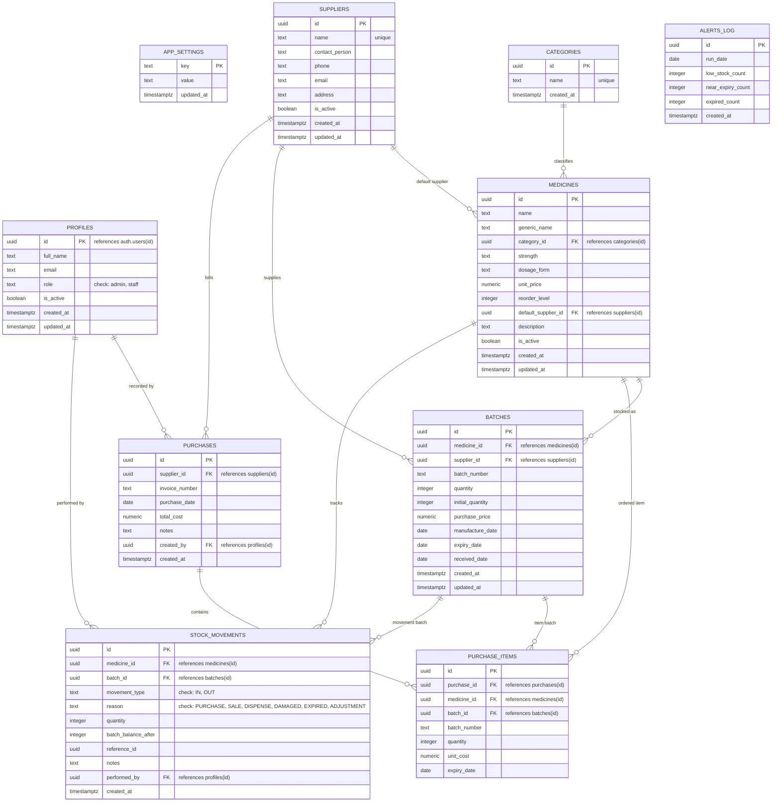

# PharmaTrack — Relational Database Architecture & Specifications

This document outlines the clinical database schema, entity relationships, integrity constraints, and algorithmic business logic for **PharmaTrack - Pharmacy Inventory Management System**.

---

## 1. Entity-Relationship Diagram (ERD)



---

## 2. Table Specifications & Integrity Constraints

| Table Name | Primary Key | Description & Integrity Rules |
| :--- | :--- | :--- |
| `app_settings` | `key (text)` | Key-value store for global institutional parameters: `pharmacy_name`, `near_expiry_days` (default 60), `default_reorder_level` (default 20). |
| `profiles` | `id (uuid -> auth.users)` | System users. Automatically seeded on signup via `handle_new_user()` security definer trigger. Roles: `admin` and `staff`. Deactivated users (`is_active = false`) are banned in Supabase Auth. |
| `categories` | `id (uuid)` | Therapeutic classifications (Antibiotic, Analgesic, Antacid, etc.). Unique name constraint. |
| `suppliers` | `id (uuid)` | Approved pharmaceutical distributors. Soft-deletable (`is_active = false`). Unique supplier name constraint. |
| `medicines` | `id (uuid)` | Master medicine catalog. Composite unique constraint on `(name, strength, dosage_form)`. Valid dosage forms: `Tablet`, `Capsule`, `Syrup`, `Injection`, `Ointment`, `Drops`, `Powder`, `Other`. |
| `batches` | `id (uuid)` | Physical stock consignments. Unique constraint on `(medicine_id, batch_number)`. Indexes on `(medicine_id, expiry_date)` and `(expiry_date)`. `quantity >= 0` check constraint. |
| `purchases` | `id (uuid)` | Consignment invoices. Immutable record of incoming goods receipt notes (GRN). Index on `purchase_date`. |
| `purchase_items` | `id (uuid)` | Itemized line rows belonging to a purchase invoice, linked to corresponding batches. |
| `stock_movements` | `id (uuid)` | **Immutable audit ledger**. Every addition, dispense, write-off, and adjustment logs an append-only row. Trigger `prevent_movement_tampering()` prohibits `UPDATE` and `DELETE`. |
| `alerts_log` | `id (uuid)` | Daily cron execution snapshots recording low stock, near-expiry, and expired counts. |

---

## 3. The Immutable Audit Ledger Concept

Healthcare and pharmaceutical dispensing regulations mandate that stock registers cannot be quietly overwritten or modified without an audit trail.

1. **Trigger Immutability**:
   The table `stock_movements` has a PostgreSQL row-level trigger `trig_protect_stock_movements`:
   ```sql
   CREATE OR REPLACE FUNCTION prevent_movement_tampering()
   RETURNS trigger AS $$
   BEGIN
       RAISE EXCEPTION 'AUDIT_LEDGER_IMMUTABLE: Historical stock movements cannot be updated or deleted.';
   END;
   $$ LANGUAGE plpgsql;
   ```
2. **Mathematical Balance Guarantee**:
   For any batch, the current physical balance matches the equation:
   $$\text{Current Quantity} = \text{Initial Quantity} + \sum \text{Adjustments}_{\text{IN}} - \sum \text{Deductions}_{\text{OUT}}$$
   This is verified automatically by `supabase/tests/ledger_check.sql`.

---

## 4. Automated FEFO (First-Expire, First-Out) Dispensing Algorithm

To minimize shelf-life degradation and eliminate clinical waste, PharmaTrack strictly implements automated FEFO logic in both SQL stored procedures (`dispense_stock`) and pure TypeScript (`lib/inventory/index.ts -> allocateFefo`).

### Step-by-Step Execution:
1. **Validation**: Check requested quantity $> 0$ and reason $\in \{\text{'SALE'}, \text{'DISPENSE'}, \text{'DAMAGED'}\}$.
2. **Batch Candidate Discovery & Row Locking**:
   ```sql
   SELECT * FROM batches
   WHERE medicine_id = p_medicine_id
     AND quantity > 0
     AND expiry_date >= app_today()
   ORDER BY expiry_date ASC, received_date ASC, created_at ASC, id ASC
   FOR UPDATE;
   ```
   - **Exclusion of Expired Batches**: Any batch where `expiry_date < app_today()` is strictly ignored and never dispensed.
   - **Deterministic Tie-Breaking**: When two batches share the exact same expiry date, the batch with the earlier `received_date`, then earlier `created_at`, then smaller `id` is consumed first.
   - **Concurrency Protection**: `FOR UPDATE` locks candidate rows in PostgreSQL to prevent double-dispensing race conditions under high concurrency.
3. **Capacity Check**:
   If the total available non-expired quantity is less than requested:
   `RAISE EXCEPTION 'INSUFFICIENT_STOCK: Only X units available (requested Y).';`
   The entire transaction aborts immediately; zero stock is deducted.
4. **Deduction & Ledger Writing**:
   Loop sequentially through locked batches:
   - Calculate $\text{take} = \min(\text{batch.quantity}, \text{remaining\_to\_dispense})$.
   - Deduct $\text{take}$ from batch `quantity`.
   - Insert row into `stock_movements` with `movement_type = 'OUT'`, `reason = p_reason`, and recorded `batch_balance_after`.
   - Decrement $\text{remaining\_to\_dispense}$.
   - Stop when $\text{remaining\_to\_dispense} = 0$.

---

## 5. Medicine Stock Status Classification Priority

Status is computed dynamically in PostgreSQL view `v_medicine_stock` and mirrored in pure TypeScript `medicineStatus()` according to this exact 5-tier strict hierarchy:

1. **`OUT_OF_STOCK`** (Priority 1):
   Condition: $\text{total\_quantity\_all} = 0$.
   The medicine is completely depleted across all batches.
2. **`EXPIRED`** (Priority 2):
   Condition: $\text{sellable\_quantity} = 0$ AND $\text{expired\_quantity} > 0$.
   All remaining physical stock on shelves has expired and cannot be dispensed.
3. **`LOW_STOCK`** (Priority 3):
   Condition: $\text{sellable\_quantity} \le \text{reorder\_level}$.
   Active non-expired stock has breached the safe reorder threshold.
4. **`NEAR_EXPIRY`** (Priority 4):
   Condition: Has at least one non-expired batch with $\text{quantity} > 0$ where $(\text{expiry\_date} - \text{today}) \le \text{near\_expiry\_days}$.
5. **`AVAILABLE`** (Priority 5):
   All other active inventory items in safe, adequate supply.

*Secondary Badge*: If an item is classified as `LOW_STOCK` but also possesses an expiring batch (e.g. Cough Syrup), the UI displays the primary `Low Stock` status accompanied by an auxiliary `Near Expiry` warning chip.

---

## 6. Timezone Handling & Date Integrity

- **Timezone**: All database dates are calculated relative to `Asia/Kolkata` (Indian Standard Time, UTC+05:30) using the helper function:
  ```sql
  CREATE OR REPLACE FUNCTION app_today() RETURNS date AS $$
      SELECT (now() AT TIME ZONE 'Asia/Kolkata')::date;
  $$ LANGUAGE sql STABLE;
  ```
- **Date Format**: Stored as Postgres `date` type (`YYYY-MM-DD`). Never parsed with `new Date("YYYY-MM-DD")` in client JavaScript (to prevent day-shifting timezone bugs); parsed deterministically via `date-fns parseISO`.
